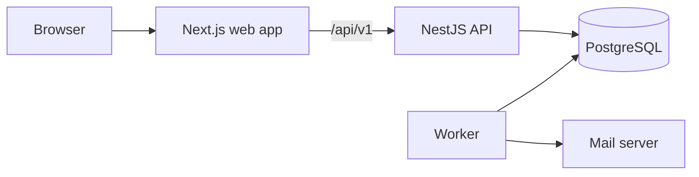

# HireFlow

**Two-sided hiring platform.** Job seekers can keep track of every job they apply for. Companies can post jobs and hire the right people.

Right now this project has the job seeker side and the main company side. Interview booking and the other parts are still being built. See [What is coming next](#what-is-coming-next).

## What works today

| Area         | What you can do                                                                          |
| ------------ | ---------------------------------------------------------------------------------------- |
| Account      | Sign up, sign in, confirm your email, reset your password, sign out on all devices       |
| Job board    | Add jobs, drag them between steps, add notes and tags, search, archive, see the history  |
| Reminders    | Get a follow-up reminder 7 days after you apply, add your own, get them in app and email |
| Your numbers | See how many jobs you applied for each week, your reply rate and how far you got         |
| Companies    | Create a company and add members as admin, recruiter, hiring manager or interviewer      |
| Hiring       | Post jobs, set your own steps, move people across a board, reject with a reason          |
| Careers page | Share one public page with all your open jobs, where people apply with a resume          |
| Team work    | Comment, send scores, and give interviewers only the people they should see              |

## How it fits together



The API holds all the business rules, and the browser only talks to the API. PostgreSQL stores the data and the job queue, so there is no second database to run. You can read more in [docs/architecture.md](docs/architecture.md).

## Tools used

| Tool                          | Why we use it                                                    |
| ----------------------------- | ---------------------------------------------------------------- |
| TypeScript                    | One language for the web app, API, worker and shared code        |
| Next.js, React, Tailwind      | Pages and styling                                                |
| TanStack Query, dnd-kit       | Instant board updates, and drag and drop that works for everyone |
| NestJS                        | Keeps the API split into clear modules                           |
| PostgreSQL                    | Stores the data, and its rules stop bad data from being saved    |
| Kysely, node-pg-migrate       | Typed queries, and database changes written in plain SQL         |
| pg-boss                       | Background jobs stored in PostgreSQL                             |
| zod                           | One set of checks shared by the forms and the API                |
| Vitest, Supertest, Playwright | Tests for code, API and the browser, using a real database       |

## How to run it

You need Node 22 or newer, Corepack (run `corepack enable`) and PostgreSQL 15 or newer. You do not need Docker.

```bash
pnpm install
cp .env.example .env
pnpm db:start
pnpm db:create
pnpm db:migrate
pnpm dev
```

Then open http://localhost:3000.

To see the hiring side with data in it, add the demo company:

```bash
pnpm db:seed
```

It prints the demo accounts and their password, and it only runs in development.

- `pnpm db:start` runs a private database from the `.pgdata/` folder on port 5433. To use a different database, change `DATABASE_URL` and skip this step.
- In `.env`, set both `JWT_` values to long random text. You can make it with `openssl rand -base64 48`.
- If `SMTP_HOST` is empty, emails are not sent. They are saved as HTML files in `.mail-preview/`, and you can click the links from there.

## How to test it

Code and API tests:

```bash
pnpm test
```

Browser tests (stop `pnpm dev` first, because they use the same ports):

```bash
pnpm build && pnpm test:e2e
```

Good tests to read first:

- `apps/api/test/auth.test.ts`: login tokens and how stolen tokens are caught
- `apps/api/test/companies.test.ts`: roles, and keeping each company's data apart
- `apps/api/test/ats.test.ts`: every hiring route with every role, other companies and bad uploads
- `apps/worker/test/reminders.test.ts`: reminders when workers crash or run at the same time
- `apps/web/e2e/tracker.spec.ts`: the full job seeker journey in a real browser
- `apps/web/e2e/hiring.spec.ts`: the full company journey in a real browser

## Settings

All settings are listed in [.env.example](.env.example). The API and the worker check them when they start, and they will not run if one is missing.

## Folders

```
apps/
  api/        NestJS API, database changes and API tests
  web/        Next.js web app and browser tests
  worker/     Background jobs for emails and reminders
packages/
  shared/     Checks and types used by all the apps
  config/     Shared TypeScript settings
docs/         How it works, API list, decisions and help for problems
scripts/      Helpers for the local database and for starting the app
```

## What is coming next

- Interview booking that never double-books anyone
- A job feed and job alerts from public job boards
- Resume upload with a clear match score
- A log for interview practice, with smart review dates
- Hiring numbers for companies
- Speed and security checks, then a public launch

## Known limits

- Rate limits are kept in memory, so they work per API server. This is fine for one server. More servers would need a shared store.
- If the worker crashes right after the mail server accepts an email, that one email could be sent twice. No mail client can fully stop this.
- Weekly numbers use UTC weeks, not your own time zone.
- Resumes are saved on the server's disk. A host with a disk that is wiped on restart needs a lasting folder for `UPLOAD_DIR`, or a new storage class.
- Until interview booking is built, people are given to interviewers by hand on the candidate page.
