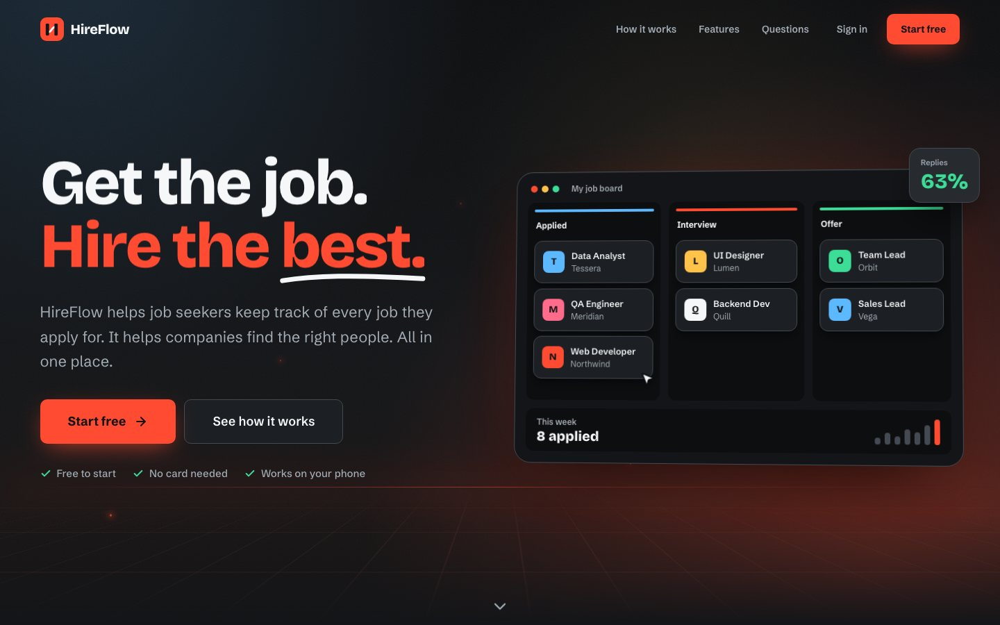
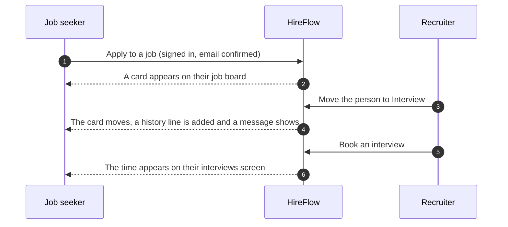
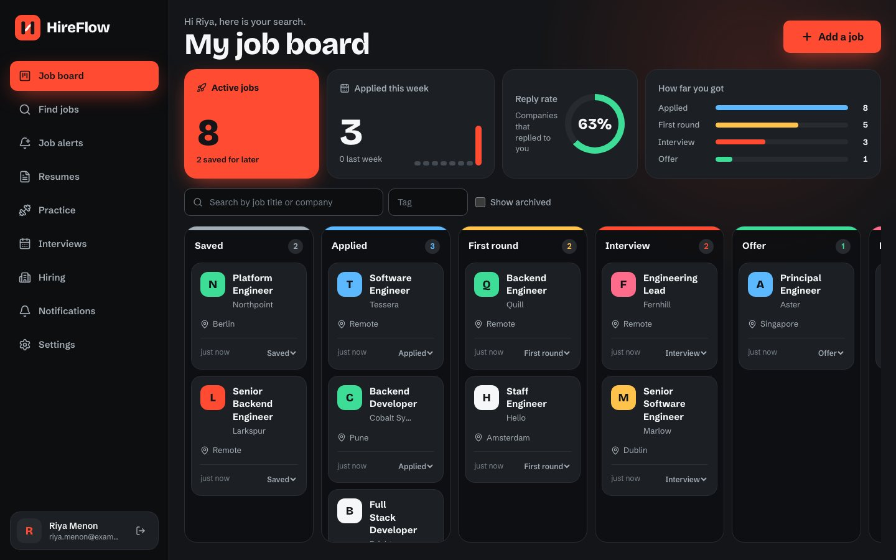
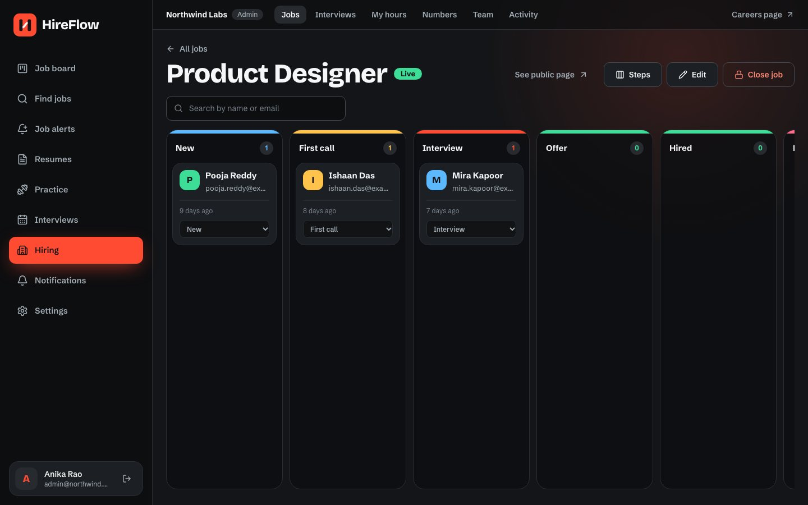
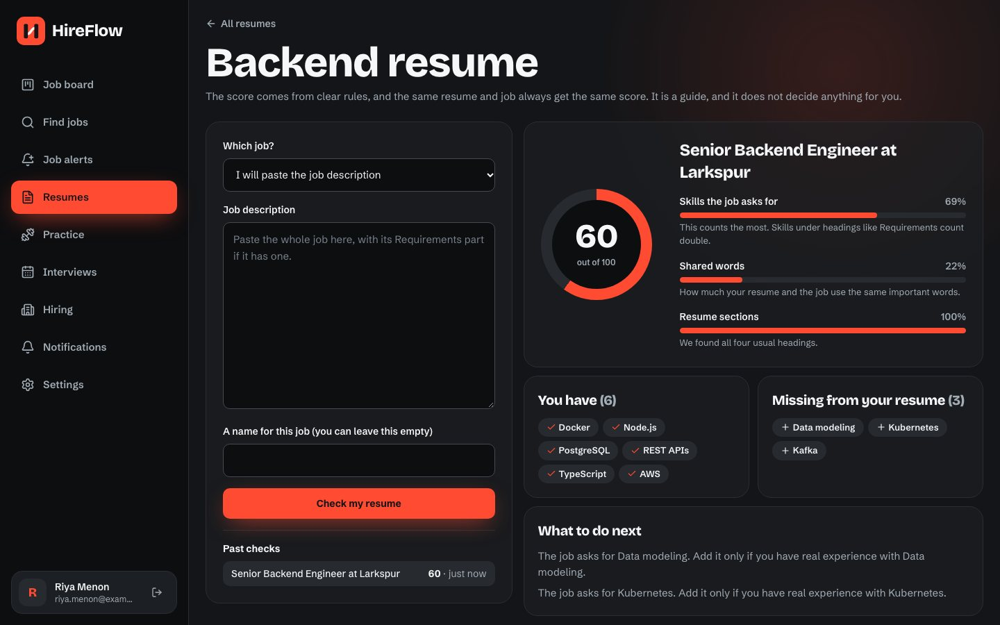
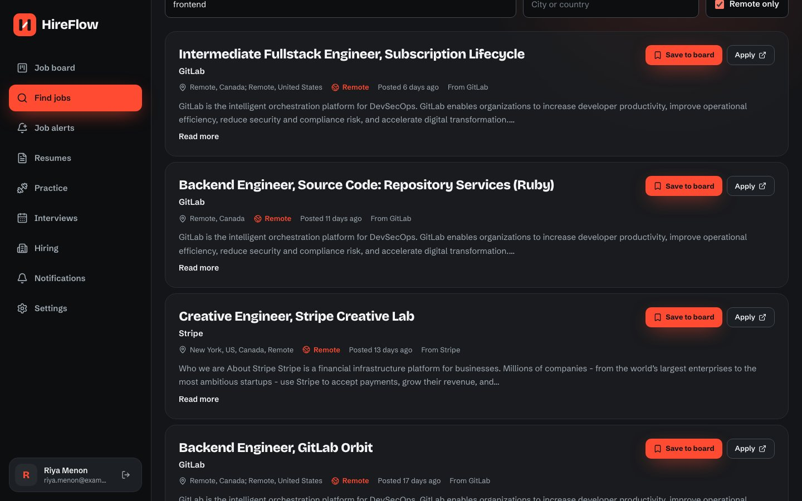
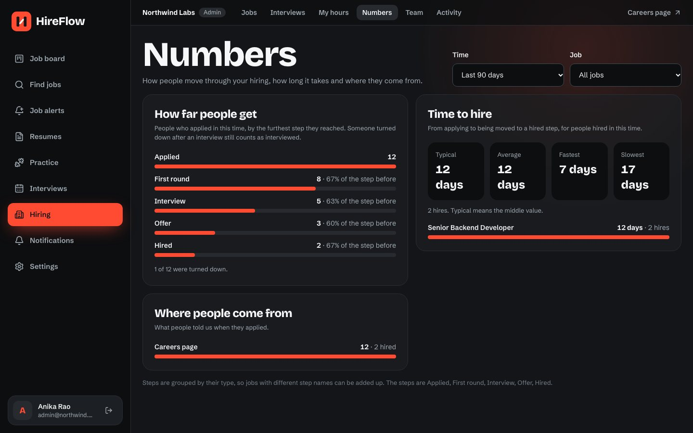
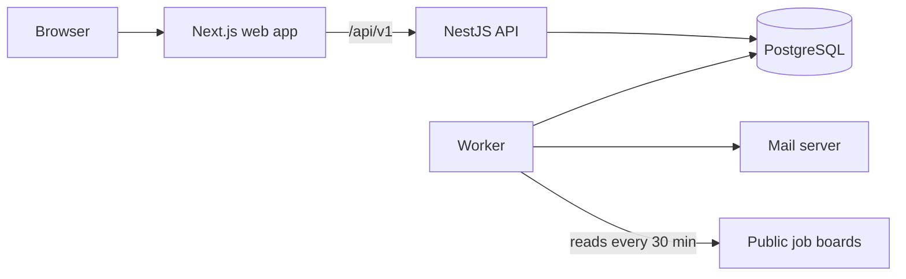

<div align="center">

# HireFlow

**The two-sided hiring platform.**
Job seekers track every application. Companies run their whole hiring process. Both sides stay in step, by themselves.

[](https://github.com/ManasSaxena14/HireFlow/actions/workflows/ci.yml)
[](LICENSE)


[Features](#features) · [Screenshots](#screenshots) · [Architecture](#architecture) · [Quick start](#quick-start) · [Quality](#quality-and-results) · [Deployment](#deployment) · [Documentation](#documentation)



</div>

## Overview

Looking for a job and hiring for one are usually two separate tools, and neither side can see the other. HireFlow puts both in one product and joins them.

- **A job seeker** keeps one job board for every application, with reminders, notes and numbers. When they apply to a company on HireFlow, the card on their board **moves by itself** as the company goes through its hiring.
- **A company** posts jobs, runs a hiring board with its own steps, scores people with its team, books interviews that can never clash, and reads its hiring numbers.
- **The platform** finds new jobs from public company job boards every 30 minutes, tells people when one matches, and checks a resume against a job with a clear score that anyone can understand.

## Features

### For job seekers

| Feature                | What it does                                                                                                             |
| ---------------------- | ------------------------------------------------------------------------------------------------------------------------ |
| **Job board**          | Drag jobs across saved, applied, first round, interview, offer and rejected. Add notes and tags, search, archive.        |
| **Live cards**         | An application made on HireFlow follows the company's hiring on its own, with a history line and a message each time.    |
| **Reminders**          | A follow-up reminder 7 days after you apply, your own reminders, and a day-and-hour notice before every interview.       |
| **Your numbers**       | Applications each week, reply rate and how far you got.                                                                  |
| **Find jobs**          | Search new jobs from public company job boards, filter by place or remote, and save one to your board in a click.        |
| **Job alerts**         | Pick keywords, places and remote. Get one email for each new job, at once or as a daily note at 8 am your time.          |
| **Resume check**       | Upload a PDF or Word resume and see a score for any job, with the skills you have, the ones you are missing and the why. |
| **Interview practice** | Log what you practise. Each topic comes back for review at the right time, using the SM-2 method, with a daily streak.   |
| **Interviews**         | See your interviews, add them to any calendar and pick your own time when a company offers choices.                      |

### For companies

| Feature                   | What it does                                                                                                                                                                      |
| ------------------------- | --------------------------------------------------------------------------------------------------------------------------------------------------------------------------------- |
| **Jobs and careers page** | Post jobs and share one public page where people apply with a resume.                                                                                                             |
| **Hiring board**          | Your own steps for each job. Drag people across, or use the keyboard. A reason is needed to turn someone down.                                                                    |
| **Team and roles**        | Admin, recruiter, hiring manager and interviewer. Interviewers only see the people given to them.                                                                                 |
| **Feedback**              | Comments, one score and a recommendation from each interviewer.                                                                                                                   |
| **Interview booking**     | Set working hours, book a free time or let the candidate choose. The database refuses double booking, even when 20 people try at once. Works across time zones and clock changes. |
| **Hiring numbers**        | How far people get, days to hire, and where people came from, for any job and time.                                                                                               |
| **Activity log**          | Who changed what. Nobody can edit or delete an entry, because the database stops it.                                                                                              |

### How the two sides join



A card is only made for someone who is signed in with a confirmed email that matches the form, because the apply form itself is open to anyone. The company's reasons for a decision never reach the candidate. Read [the choices made](docs/decisions/013-live-boards.md).

## Screenshots

|                                                                                                                                               |                                                                                                                                                   |
| --------------------------------------------------------------------------------------------------------------------------------------------- | ------------------------------------------------------------------------------------------------------------------------------------------------- |
|  <br> **Job board**: every application in one place, with live numbers  |  <br> **Hiring board**: a company's own steps, with a score on each person |
|  <br> **Resume check**: a clear score, what you have and what is missing  |  <br> **Find jobs**: new jobs from public job boards, ready to save                       |
|  <br> **Hiring numbers**: how far people get and how long it takes |                                                                                                                                                   |

## Architecture



- **One database does three jobs.** PostgreSQL holds the data, the background job queue (pg-boss) and the full-text search. There is no second system to run, which keeps hosting free and simple.
- **The API holds every rule.** The browser only talks to the API, and the web server passes `/api/v1` on, so the login cookie works even when the API lives on another host.
- **The worker does slow things.** It sends email, scans for reminders, reads job boards, matches alerts, reads resumes on a separate thread with time and memory limits, and cleans up old rows. Every job is safe to run twice.
- **The database defends the important rules,** not only the code: no overlapping interviews, one application for each person and job, and an activity log that cannot be changed.

| Layer         | Tools                                                                                       |
| ------------- | ------------------------------------------------------------------------------------------- |
| Web           | Next.js 16, React 19, Tailwind CSS 4, TanStack Query, dnd-kit, React Hook Form, Luxon       |
| API           | NestJS 12, Kysely (typed SQL), zod checks shared with the web app, Argon2id, JWT, pino logs |
| Data          | PostgreSQL 15+, 11 reversible SQL migrations, pg-boss queue                                 |
| Worker        | Node, nodemailer, unpdf and fflate for resumes                                              |
| Quality       | Vitest, Supertest, Playwright, k6, ESLint, Prettier, Husky, GitHub Actions                  |
| Code language | TypeScript, in one shared workspace (pnpm)                                                  |

More in [docs/architecture.md](docs/architecture.md) and the [13 decision records](docs/decisions).

## Quick start

You need Node 22 or newer, Corepack (`corepack enable`) and PostgreSQL 15 or newer. **No Docker.**

```bash
pnpm install
cp .env.example .env     # then set the two JWT values: openssl rand -base64 48
pnpm db:start            # a private database in .pgdata/ on port 5433
pnpm db:create
pnpm db:migrate
pnpm db:seed             # optional: a demo company with people, jobs and an interview
pnpm feed:sources        # optional: the public job boards the worker reads
pnpm dev
```

Open <http://localhost:3000>. In development, emails are saved as files in `.mail-preview/`, and you can click the links from there.

**Demo accounts** (development only, password `demo-password-123`):

| Account                         | Role           |
| ------------------------------- | -------------- |
| `admin@northwind.example`       | Company admin  |
| `recruiter@northwind.example`   | Recruiter      |
| `manager@northwind.example`     | Hiring manager |
| `interviewer@northwind.example` | Interviewer    |

Or create a new account to see the job seeker side. The demo company's public careers page is at `/c/northwind-labs`.

### Commands

| Command                                | What it does                                                       |
| -------------------------------------- | ------------------------------------------------------------------ |
| `pnpm dev`                             | Runs the web app, the API and the worker, and rebuilds as you edit |
| `pnpm build` / `pnpm start`            | Builds everything, then runs the API and worker for production     |
| `pnpm test`                            | Code and API tests, against a real database                        |
| `pnpm build && pnpm test:e2e`          | Browser tests (stop `pnpm dev` first, they use the same ports)     |
| `pnpm lint` · `pnpm format:check`      | Code rules and formatting                                          |
| `pnpm typecheck`                       | Types in every package                                             |
| `pnpm coverage`                        | Test coverage for the API, worker and shared code                  |
| `pnpm db:migrate` · `pnpm db:rollback` | Apply or undo database changes                                     |
| `pnpm screenshots`                     | Retakes the pictures in this README, from a running local app      |
| `k6 run scripts/load/mixed.js`         | Load test, with the plan's speed targets as pass or fail           |

## Quality and results

Every number below was measured, on one laptop (Apple M3, 8 cores) with the API, database and test tool all running together. [docs/performance.md](docs/performance.md) has the full tables, and it also says where a target was missed.

| Area                 | Result                                                                                                                                                                |
| -------------------- | --------------------------------------------------------------------------------------------------------------------------------------------------------------------- |
| **Tests**            | 418 code and API tests and 26 browser tests, all passing. The API's own code has about 97% of its lines covered                                                       |
| **Speed, 50 users**  | 95% of requests under 106 ms for reads and 38 ms for a mix of reads and writes, with 0 errors, against a target of 300 ms                                             |
| **Speed, 200 users** | 95% under 525 ms, which misses the 300 ms target. One Node process on a shared laptop is the limit, and the page says how to scale                                    |
| **Start-up**         | The API and worker are ready about one second after they start, which matters on hosts that put apps to sleep                                                         |
| **Queries**          | Every busy query was checked with `EXPLAIN ANALYZE` on large test data (200,000 jobs on boards, 50,000 feed posts). One slow search was found and fixed with an index |
| **Database changes** | Every migration is applied, undone and applied again in CI                                                                                                            |
| **Delivery**         | `main` is protected. A change needs a pull request and a passing CI run, with lint, types, tests, audit and browser tests                                             |

### Security

Argon2id passwords. Short-lived access tokens and refresh tokens that change on every use, so a stolen one is caught. Roles checked on every company route, and a test for each role. Resumes are checked by their bytes, saved under random names and shared by short-lived signed links. Rate limits on sign-in and apply. Strict security headers and a list of allowed sites. No known vulnerable packages. The API refuses to start in production with unsafe settings. See the [security checklist](docs/security.md), checked against the plan one rule at a time.

## Deployment

HireFlow is built to run on **free hosting** where the backend and the database sleep when nobody uses them.

- The browser wakes the server as soon as a page opens, and waits patiently, with a note on screen, instead of failing or signing anyone out.
- Closed database connections are handled, memory is capped to fit 512 MB, and the API starts in about a second.
- A free uptime check that calls `/api/v1/health` every 10 minutes keeps it awake all day.

The step-by-step guide for a free web host, a free Node host and a free database is in [docs/deployment.md](docs/deployment.md). The app has not been deployed yet, so there is no live address.

<details>
<summary><strong>Settings you fill in at deployment</strong></summary>

<br>

| Name                                                            | Value                                                           |
| --------------------------------------------------------------- | --------------------------------------------------------------- |
| `NODE_ENV`                                                      | `production`                                                    |
| `APP_URL`, `CORS_ORIGINS`                                       | The public address of the web site                              |
| `API_URL` (web host, set before the build)                      | The public address of the API                                   |
| `DATABASE_URL`                                                  | The direct connection string of your database                   |
| `JWT_ACCESS_SECRET`, `JWT_REFRESH_SECRET`                       | Two different random values from `openssl rand -base64 48`      |
| `COOKIE_SECURE`                                                 | `true` (the API will not start without it)                      |
| `TRUST_PROXY_HOPS`                                              | `2` when the web host passes requests on to a separate API host |
| `SMTP_HOST`, `SMTP_PORT`, `SMTP_USER`, `SMTP_PASS`, `MAIL_FROM` | Your mail service (the worker will not start without a host)    |
| `UPLOAD_DIR`                                                    | A full path on a disk that survives restarts                    |

Everything else has a safe default. All settings are in [.env.example](.env.example), and the API and worker check them when they start.

</details>

## Project layout

```
apps/
  api/        NestJS API, SQL migrations and API tests
  web/        Next.js web app and browser tests
  worker/     Background jobs: email, reminders, job feed, alerts, resume reading
packages/
  shared/     Checks, types, the skills list and the resume score, used by every app
  config/     Shared TypeScript settings
docs/         Architecture, API, security, performance, deployment and decisions
scripts/      Local database, demo data, job sources, load tests and screenshots
```

## Documentation

| Document                                                 | What is in it                                                                            |
| -------------------------------------------------------- | ---------------------------------------------------------------------------------------- |
| [Architecture](docs/architecture.md)                     | How each part works, with the reasons                                                    |
| [API list](docs/api.md) and [OpenAPI](docs/openapi.json) | All 95 operations. The OpenAPI file is made from the code, and a test fails if it drifts |
| [Decision records](docs/decisions)                       | Why the plan was changed or filled in, one record for each area                          |
| [Speed and test results](docs/performance.md)            | Load tests, query plans and coverage, measured                                           |
| [Security checklist](docs/security.md)                   | Every security rule, and where the code keeps it                                         |
| [Deployment](docs/deployment.md)                         | Free hosting, step by step                                                               |
| [Runbook](docs/runbook.md)                               | Running it, releasing, clean-up jobs and finding an error                                |

## Known limits

- Keep the project folder out of iCloud and other sync tools. They create copies like `ats 2.ts` while you work.
- Rate limits live in memory, so they work for one API server. More servers would need a shared store.
- Resumes are saved on the server's disk. A host whose disk is wiped on restart needs a lasting folder, or a new storage class.
- If the worker crashes right after the mail server accepts an email, that one email could be sent twice. No mail client can fully prevent this.
- An interview has one interviewer. Free times can be checked for up to five people, but panel interviews are not built yet.
- Weekly numbers use UTC weeks, not the person's own time zone.

## Licence

[MIT](LICENSE). You may use, change and share this code, also in paid work, as long as you keep the copyright and licence notice.
