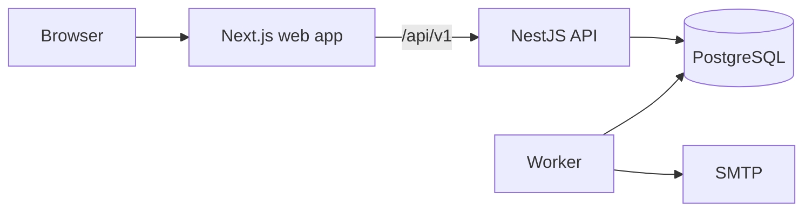

# HireFlow

**Two-sided hiring platform.** Job seekers keep a clear record of every application. Hiring teams get a shared pipeline they can trust.

This repository currently contains the platform foundation and the candidate job tracker. The hiring team features are under active development, see [Roadmap](#roadmap).

## What works today

| Area        | Features                                                                                                                        |
| ----------- | ------------------------------------------------------------------------------------------------------------------------------- |
| Accounts    | Registration, email verification, password reset, sessions that survive a reload, sign out everywhere                           |
| Job tracker | Kanban board with drag and drop, a move menu for keyboard and touch, duplicate detection, notes, tags, search, archive, history |
| Reminders   | Automatic follow-up seven days after applying, custom reminders, in-app notifications and email                                 |
| Insights    | Applications per week, response rate and a stage funnel from your own data                                                      |
| Companies   | Workspaces with admin, recruiter, hiring manager and interviewer roles, plus an append-only audit log                           |

## Architecture



The API owns every business rule, and the browser only ever talks to the API. PostgreSQL holds the data as well as the job queue, so there is no second datastore to run. More detail in [docs/architecture.md](docs/architecture.md).

## Tech stack

| Tool                          | Why                                                                    |
| ----------------------------- | ---------------------------------------------------------------------- |
| TypeScript (strict)           | One language across web, API, worker and shared code                   |
| Next.js, React, Tailwind      | App Router for routing, utility CSS over a small set of design tokens  |
| TanStack Query, dnd-kit       | Optimistic board updates; accessible drag and drop                     |
| NestJS                        | Clear module boundaries and guards for auth and tenancy                |
| PostgreSQL                    | Source of truth; constraints do the work that app code would get wrong |
| Kysely, node-pg-migrate       | Typed queries over hand-written, reversible SQL migrations             |
| pg-boss                       | Reliable jobs in Postgres, so they can commit in the same transaction  |
| zod                           | One set of schemas shared by the forms and the API                     |
| Vitest, Supertest, Playwright | Unit, API and end-to-end tests against a real database                 |

## Getting started

You need Node 22+, Corepack (`corepack enable`) and PostgreSQL 15+ on your `PATH`. No containers are involved.

```bash
pnpm install
cp .env.example .env
pnpm db:start
pnpm db:create
pnpm db:migrate
pnpm dev
```

Then open http://localhost:3000.

- `pnpm db:start` runs a private database cluster from `.pgdata/` on port 5433. To use another server, change `DATABASE_URL` and skip that step.
- Set the two `JWT_*` values in `.env` to long random strings (`openssl rand -base64 48`).
- With `SMTP_HOST` empty, emails are written to `.mail-preview/` as HTML files, so you can follow verification and reset links without a mail account.

## Tests

```bash
pnpm test
```

```bash
pnpm build && pnpm test:e2e
```

The first command runs the unit and API tests. The second runs the browser suite against the real API, worker and database; stop `pnpm dev` first because it uses the same ports.

Worth reading if you want to see the harder guarantees being tested:

- `apps/api/test/auth.test.ts`: refresh token rotation and reuse detection
- `apps/api/test/companies.test.ts`: role checks and tenant isolation
- `apps/worker/test/reminders.test.ts`: reminders under parallel workers, crashes and restarts
- `apps/web/e2e/tracker.spec.ts`: the whole journey, including a real reminder reaching the inbox once

## Environment variables

All of them are listed with comments in [.env.example](.env.example). The API and the worker validate their configuration on startup and refuse to run if something is missing.

## Project layout

```
apps/
  api/        NestJS API, SQL migrations, API tests
  web/        Next.js app, Playwright tests
  worker/     Background jobs: mail, reminders
packages/
  shared/     zod schemas, enums and types used by every app
  config/     Shared TypeScript settings
docs/         Architecture, API reference, decisions, runbook
scripts/      Local database and start-up helpers
```

## Roadmap

- Applicant tracking: job posts, careers pages, pipelines, scorecards
- Interview scheduling with database-enforced protection against double booking
- Job feed and alerts from public job boards
- Resume upload with an explainable match score
- Interview practice log with spaced repetition
- Hiring analytics
- Hardening, load testing and public deployment

## Known limitations

- Rate limits are held in memory, so they apply per API instance. That is fine for one instance and would need a shared store beyond it.
- A crash in the moment between the mail server accepting a message and the delivery being recorded can send that one email twice. No SMTP client can fully close that gap.
- Weekly statistics use UTC week boundaries rather than the viewer's time zone.
