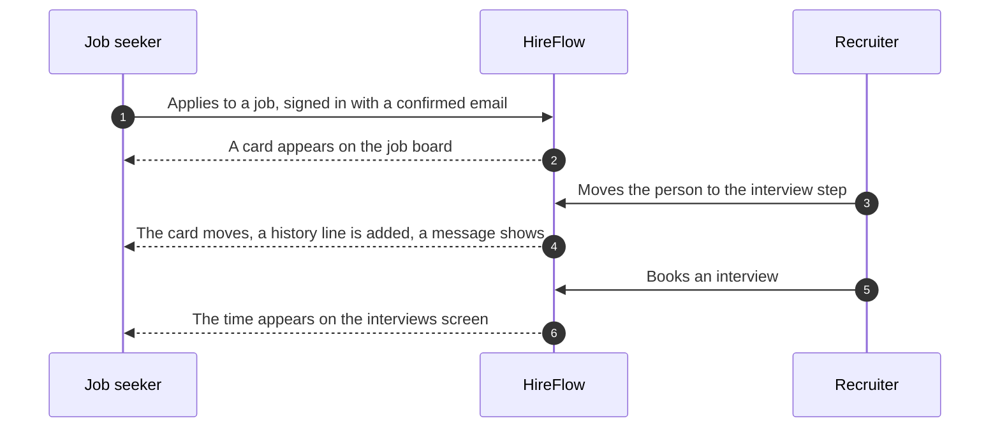
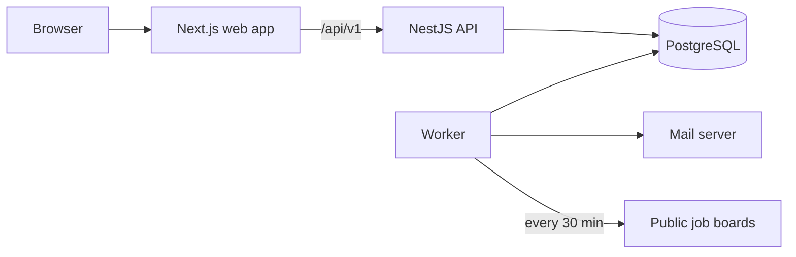

# HireFlow

HireFlow is a two-sided hiring platform. Job seekers manage their applications on one board. Companies run their hiring on another. The two boards are connected, so a company's decision shows up on the candidate's board without anyone doing extra work.

|                   |                                                                   |
| ----------------- | ----------------------------------------------------------------- |
| **Version**       | 1.1.1                                                             |
| **Status**        | Feature complete. Not deployed yet. See [Deployment](#deployment) |
| **Licence**       | [MIT](LICENSE)                                                    |
| **Runtime**       | Node.js 22 or newer, PostgreSQL 15 or newer                       |
| **Code language** | TypeScript, in one pnpm workspace                                 |
| **Maintainer**    | Manas Saxena                                                      |

## Contents

1. [Product scope](#product-scope)
2. [System design](#system-design)
3. [Getting started](#getting-started)
4. [Configuration](#configuration)
5. [Development workflow](#development-workflow)
6. [Testing](#testing)
7. [Quality targets and results](#quality-targets-and-results)
8. [Security](#security)
9. [Operations](#operations)
10. [Deployment](#deployment)
11. [Repository layout](#repository-layout)
12. [Documentation](#documentation)
13. [Known limits](#known-limits)

## Product scope

### Users and roles

| User           | Who they are                       | What they can do                                                       |
| -------------- | ---------------------------------- | ---------------------------------------------------------------------- |
| Job seeker     | Anyone with an account             | Track applications, find jobs, check resumes, practise, see interviews |
| Company admin  | Creates and owns a company         | Everything below, plus the team, roles and the activity log            |
| Recruiter      | Runs hiring for the company        | Jobs, hiring board, interviews, hiring numbers                         |
| Hiring manager | Decides with the recruiter         | The same as a recruiter                                                |
| Interviewer    | Takes part in interviews           | Only the candidates given to them: feedback, comments, their own hours |
| Candidate      | Applies from a public careers page | No account needed. Books a time from a signed link                     |

### Capabilities

**Job seeker side**

- **Job board.** Drag jobs across saved, applied, first round, interview, offer and rejected. Notes, tags, search, archive and a full history for each card.
- **Live cards.** An application made on HireFlow follows the company's hiring by itself. Each change adds a history line and a notification.
- **Reminders.** A follow-up reminder 7 days after applying, custom reminders, and a notice a day and an hour before each interview. Sent in the app and by email.
- **Personal numbers.** Applications each week, reply rate and how far each application got.
- **Job feed.** New jobs from public company job boards, checked every 30 minutes. Search by words, place and remote. Save any job to the board.
- **Job alerts.** Keywords, places and remote. One email for each new job, or one daily email at 8 am in the person's own time zone.
- **Resume check.** Upload a PDF or Word resume. Get a score from 0 to 100 for any job, with the skills found, the skills missing and how the score was made.
- **Interview practice.** Log practice sessions. Each topic returns for review on the SM-2 schedule. Daily streak and totals by type and topic.
- **Interviews.** One list of upcoming interviews, calendar files and a page to pick a time when a company offers choices.

**Company side**

- **Jobs and careers page.** Draft, publish and close jobs. One public page lists open jobs, and people apply there with a resume.
- **Hiring board.** Steps are set for each job. Move people with drag and drop or the keyboard. A written reason is required to turn someone down.
- **Team work.** Comments, one score from each interviewer, and role-based access.
- **Interview booking.** Working hours for each person, free-time search across up to five people, booking by a recruiter, or a signed link for the candidate. Double booking is impossible, because the database refuses it.
- **Hiring numbers.** Funnel, days to hire and source of applicants, for any job and date range.
- **Activity log.** A read-only record of who changed what. The database blocks edits and deletes.

### How the two boards connect



Rules that keep this safe:

- A card is made only when the applicant is signed in, the account's email is confirmed, and it matches the email on the form. The apply form is open to anyone, so an email alone proves nothing.
- A later move by the company updates an existing card. It never creates one.
- The company's reasons for a decision are never sent to the candidate.
- If the person moves a linked card by hand, the company's next move puts it back in step.
- The screens ask the server again every 15 to 60 seconds while a tab is in view. A new notification refreshes the affected screens at once. Boards being dragged are not refreshed.

Full reasoning: [decision 013](docs/decisions/013-live-boards.md).

## System design



### Principles

- **One datastore.** PostgreSQL holds the data, the job queue (pg-boss) and full-text search. There is no cache or message broker to run, which keeps hosting simple and free.
- **The API owns the rules.** The browser only talks to the API. The web server forwards `/api/v1`, so the browser never talks to another host. Neon Auth is reached the same way, through `/api/auth`.
- **The database enforces the rules that matter.** No overlapping interviews for a person, one application for each person and job, and an activity log that cannot be changed.
- **Shared checks.** One set of zod schemas validates both the forms and the API.
- **Safe to repeat.** Every background job can run twice with the same result. Emails are sent once, matched jobs are delivered once, and reminders fire once.
- **Typed end to end.** Kysely gives typed SQL, and the types are shared with the web app.

### Technology

| Layer   | Technology                                                                            |
| ------- | ------------------------------------------------------------------------------------- |
| Web     | Next.js 16, React 19, Tailwind CSS 4, TanStack Query, dnd-kit, React Hook Form, Luxon |
| API     | NestJS 12, Kysely, zod, jose (checks Neon Auth tokens), pino                          |
| Data    | PostgreSQL 15 or newer, node-pg-migrate (11 reversible SQL migrations), pg-boss       |
| Worker  | Node.js, nodemailer, unpdf and fflate for reading resumes                             |
| Tooling | pnpm workspaces, ESLint, Prettier, Husky, Vitest, Supertest, Playwright, k6           |
| CI      | GitHub Actions                                                                        |

### Background jobs

| Job              | When it runs             | What it does                                                          | Retries          |
| ---------------- | ------------------------ | --------------------------------------------------------------------- | ---------------- |
| `mail`           | When any email is needed | Renders and sends one email                                           | 5, with back-off |
| `reminders-scan` | Every minute             | Turns due reminders into notifications and emails                     | Next minute      |
| `resume-parse`   | After a resume upload    | Reads the file on its own thread, saves text and skills               | 3                |
| `feed-fetch`     | Every 30 minutes         | Reads each job board, saves new jobs, marks a failing board as failed | 3 per board      |
| `alerts-match`   | After each fetch         | Matches new jobs to alerts and saves one delivery for each pair       | 3                |
| `alerts-digest`  | Every 15 minutes         | Sends instant alerts, and daily alerts at 8 am in each person's zone  | 3                |
| `cleanup`        | Every day at 03:00       | Removes expired tokens, old delivery rows and jobs gone from boards   | Next day         |

### Data

Migrations are plain SQL files in `apps/api/migrations`. CI applies all of them, undoes all of them and applies them again.

| Migration | Contents                                                            |
| --------- | ------------------------------------------------------------------- |
| 001       | Extensions and enums                                                |
| 002       | Users, companies, memberships, tokens and the activity log          |
| 003       | Email delivery records                                              |
| 004       | Job board, history, notes, reminders and notifications              |
| 005       | Hiring: jobs, steps, candidates, applications, feedback and files   |
| 006       | Working hours, interviews (with overlap rules) and interview offers |
| 007       | Job feed, alerts and deliveries                                     |
| 008       | Resumes and resume checks                                           |
| 009       | Practice sessions and review items                                  |
| 010       | Trigram index for searching jobs by place                           |
| 011       | Link between a job board card and a company application             |

## Getting started

### Prerequisites

- Node.js 22 or newer
- Corepack, to get the right pnpm version: `corepack enable`
- PostgreSQL 15 or newer, with the `btree_gist`, `pgcrypto` and `pg_trgm` extensions. The local helper below runs a private copy, so you do not need to install a server yourself.
- Docker is not used anywhere in this project.

### Run it locally

```bash
pnpm install
cp .env.example .env
```

Open `.env` and set `NEON_AUTH_COOKIE_SECRET` and `LINK_SECRET` to long random values. Make each one with `openssl rand -base64 48`.

Sign-up and sign-in run in [Neon Auth](https://neon.com/docs/auth/overview) when live, which is free for up to 60,000 users a month. On your computer, `pnpm dev` starts a stand-in for it from `packages/local-auth`. It is the same Better Auth that Neon runs, with the same cookies and tokens, so you need no internet and no Neon project. To use the real Neon Auth instead, put its Auth URL in `NEON_AUTH_BASE_URL`.

Then:

```bash
pnpm db:start        # a private database in .pgdata/ on port 5433
pnpm db:create       # the development and test databases
pnpm db:migrate      # apply the schema
pnpm db:seed         # optional: a demo company with people, jobs and an interview
pnpm feed:sources    # optional: add the public job boards the worker reads
pnpm dev             # web on 3000, API on 4000, the worker, and sign-in on 4300
```

Open <http://localhost:3000>.

Email is not sent in development. With `SMTP_HOST` empty, each email is saved as an HTML file in `.mail-preview/`, so you can open it and follow its links. The sign-in stand-in saves its email codes and reset links there too, and also prints them in the terminal.

### Demo accounts

Created by `pnpm db:seed`. Development only.

| Account                         | Role           |
| ------------------------------- | -------------- |
| `admin@northwind.example`       | Company admin  |
| `recruiter@northwind.example`   | Recruiter      |
| `manager@northwind.example`     | Hiring manager |
| `interviewer@northwind.example` | Interviewer    |

Sign up with one of these addresses, with any password of 10 or more characters, and type the code from `.mail-preview/` or the terminal. The first confirmed sign-in takes over the demo account with its role. An address that is not confirmed never takes over an account. With the real Neon Auth, run `DEMO_EMAIL=you@gmail.com pnpm db:seed` instead, so the codes reach your inbox at `you+hf-admin@gmail.com` and so on.

To see the job seeker side, create a new account on the sign-up page. The demo company's public careers page is at `/c/northwind-labs`.

### Check that it works

```bash
curl http://localhost:4000/api/v1/ready      # {"status":"ready"}
```

## Configuration

The API and the worker check their settings when they start. They stop with a clear message if one is wrong. The full example is in [.env.example](.env.example).

| Name                      | Used by          | Default                 | Notes                                                                 |
| ------------------------- | ---------------- | ----------------------- | --------------------------------------------------------------------- |
| `NODE_ENV`                | all              | `development`           | Use `production` when live                                            |
| `LOG_LEVEL`               | API, worker      | `info`                  |                                                                       |
| `PORT`                    | API              | `4000`                  | Most hosts set this for you                                           |
| `APP_URL`                 | API, worker      | none, required          | Public address of the web site. Used in email links                   |
| `API_URL`                 | web              | `http://localhost:4000` | Address of the API. Set it before the web build                       |
| `CORS_ORIGINS`            | API              | none, required          | Allowed web addresses, separated by commas                            |
| `DATABASE_URL`            | API, worker      | none, required          | Use the direct connection, not a pooled one                           |
| `TEST_DATABASE_URL`       | tests            | none                    | A separate database that tests may erase                              |
| `NEON_AUTH_BASE_URL`      | API, web         | none, required          | The Auth URL from Neon. Must be `https://` in production              |
| `NEON_AUTH_COOKIE_SECRET` | web              | none, required          | Signs the session cookie. At least 32 characters                      |
| `LINK_SECRET`             | API              | none, required          | Signs interview booking links and file links. At least 32 characters  |
| `LOCAL_AUTH_VERIFY_EMAIL` | sign-in stand-in | `true`                  | Set to `false` to skip the email code on your computer                |
| `TRUST_PROXY_HOPS`        | API              | `1`                     | Use `2` when the web host forwards to an API on another host          |
| `SMTP_HOST`               | worker           | empty                   | Required in production. Empty in development saves emails as files    |
| `SMTP_PORT`               | worker           | `587`                   | `465` for a secure connection                                         |
| `SMTP_USER`, `SMTP_PASS`  | worker           | empty                   | Login for the mail service                                            |
| `MAIL_FROM`               | API, worker      | none, required          | The sender name and address                                           |
| `UPLOAD_DIR`              | API, worker      | `uploads`               | Must be a lasting disk in production, and the same for both processes |
| `RATE_LIMIT_USER_PER_MIN` | API              | `100`                   | Requests for each signed-in person                                    |
| `RATE_LIMIT_AUTH_PER_MIN` | API              | `10`                    | Sign-in type requests for each address                                |
| `FOLLOW_UP_DAYS`          | API              | `7`                     | Days before the automatic follow-up reminder                          |
| `API_MEMORY_MB`           | `pnpm start`     | `256`                   | Memory cap for the API process                                        |
| `WORKER_MEMORY_MB`        | `pnpm start`     | `160`                   | Memory cap for the worker process                                     |

In production the API refuses to start if `LINK_SECRET` still holds the example text or if `NEON_AUTH_BASE_URL` is not `https://`.

## Development workflow

### Commands

| Command                               | Purpose                                                                                                                        |
| ------------------------------------- | ------------------------------------------------------------------------------------------------------------------------------ |
| `pnpm dev`                            | Run web, API and worker, and rebuild on every change                                                                           |
| `pnpm build`                          | Build every package. `build:server` and `build:web` build one side. `build:render` also saves compiled code for a faster start |
| `pnpm start`                          | Run the API and worker together, for production                                                                                |
| `pnpm lint`                           | ESLint                                                                                                                         |
| `pnpm format` / `pnpm format:check`   | Prettier, write or check                                                                                                       |
| `pnpm typecheck`                      | TypeScript in every package                                                                                                    |
| `pnpm test`                           | Code and API tests against a real database                                                                                     |
| `pnpm test:e2e`                       | Browser tests. Stop `pnpm dev` first, because they use the same ports                                                          |
| `pnpm coverage`                       | Test coverage for the API, worker and shared code                                                                              |
| `pnpm db:migrate` / `db:rollback`     | Apply or undo database changes                                                                                                 |
| `pnpm db:seed`                        | Demo data. Development only                                                                                                    |
| `pnpm feed:sources`                   | Add the starting list of public job boards                                                                                     |
| `pnpm --filter @hireflow/api openapi` | Rebuild `docs/openapi.json` from the code                                                                                      |

### Conventions

- **Commits** use short, clear messages in the form `type: what changed`, such as `fix:`, `feat:`, `docs:` and `chore:`.
- **Pre-commit hook.** Husky runs ESLint and Prettier on the files you changed.
- **CI** runs on every push to `main` and on every pull request. It installs with the lock file, audits packages, lints, checks formatting and types, applies and undoes migrations, runs all tests, builds, and runs the browser tests.
- **Database changes** are new numbered SQL files with both an up and a down step. Never edit a migration that has been released.
- **Decisions** that change or fill in the plan get a short record in `docs/decisions`.
- **Code and text** use plain, easy English, in the screens, errors, emails, comments and documents.

## Testing

| Level   | Tool                 | Count | What it covers                                                                                                            |
| ------- | -------------------- | ----- | ------------------------------------------------------------------------------------------------------------------------- |
| Shared  | Vitest               | 38    | Schemas, the resume score, the SM-2 schedule                                                                              |
| API     | Vitest and Supertest | 315   | Every route with every role, other companies' data, bad uploads, booking races, live cards, Neon Auth tokens              |
| Worker  | Vitest               | 58    | Reminders, email delivery, job board adapters from recorded answers, alerts, resume reading                               |
| Browser | Playwright           | 30    | Sign-up with the email code, password reset, the job seeker journey, the recruiter journey, booking, live boards, resumes |
| Load    | k6                   | 2     | A read-heavy test and a mixed read and write test, with the speed targets as pass or fail                                 |

Tests use a real PostgreSQL database and never call the network. Job board tests use recorded answers. Some tests worth reading first:

- `apps/api/test/ats.test.ts`: every hiring route, with every role
- `apps/api/test/scheduler.test.ts`: 20 requests racing for one interview time
- `apps/api/test/live-link.test.ts`: the job board following the hiring process
- `apps/worker/test/feed.test.ts`: no duplicate jobs, one delivery for each alert
- `apps/web/e2e/live-board.spec.ts`: a recruiter and a candidate, with both boards updating

## Quality targets and results

Measured on one laptop (Apple M3, 8 cores), with the API, the database and the load tool all running on it. The full tables and the method are in [docs/performance.md](docs/performance.md).

| Target                                  | Result                                                                           | Met |
| --------------------------------------- | -------------------------------------------------------------------------------- | --- |
| 95% of requests under 300 ms, 50 users  | 106 ms for reads, 38 ms for reads and writes, with no errors                     | Yes |
| 95% of requests under 300 ms, 200 users | 525 ms. One Node process on a shared laptop is the limit                         | No  |
| Errors under 1%                         | 0% in every run                                                                  | Yes |
| Ready quickly after a cold start        | About 1 second from start to ready                                               | Yes |
| Query plans reviewed on large data      | Checked on 200,000 board jobs and 50,000 feed jobs. One slow search got an index | Yes |
| API test coverage                       | 97% of lines                                                                     | Yes |
| Migrations reversible                   | Applied, undone and applied again in every CI run                                | Yes |

## Security

| Area               | Control                                                                                                                  |
| ------------------ | ------------------------------------------------------------------------------------------------------------------------ |
| Sign-in            | Neon Auth runs sign-up, sign-in, passwords, email codes and password reset. HireFlow stores no passwords                 |
| Sessions           | The API accepts only Neon Auth tokens signed with Ed25519, for the right issuer and audience, valid for 15 minutes       |
| Access control     | Role checked on every company route. An outsider gets a 404, so company names cannot be guessed                          |
| Tenant separation  | Every company query uses the company id the guard checked, never one from the request                                    |
| Uploads            | PDF or Word only, 5 MB, checked by file bytes, saved under random names, shared by short-lived signed links              |
| Abuse limits       | 100 requests a minute for each person. 10 a minute for each address on apply and booking. Neon Auth limits sign-in tries |
| Browser protection | Security headers, a list of allowed sites, and cookies that are `Secure` in production                                   |
| Audit              | Role changes, job publish and close, step moves, feedback and candidate deletion. Entries cannot be changed              |
| Dependencies       | `pnpm audit` in every CI run, and automatic update proposals                                                             |
| Start-up checks    | The API stops in production if a setting is unsafe                                                                       |

The checklist, rule by rule, is in [docs/security.md](docs/security.md). It also says what was left out and why.

## Operations

- **Health.** `GET /api/v1/health` answers while the process is alive. `GET /api/v1/ready` also checks the database.
- **Logs.** JSON logs with a request id. The same id is in every error body, so one id finds one failure. Passwords, tokens and resume text are never logged.
- **Releases.** Run `pnpm db:migrate`, then start the new version, then check `/api/v1/ready`.
- **Clean-up.** A nightly job removes expired tokens, old delivery rows and jobs no longer on their board.
- **Job boards.** A board that fails is marked as failed and retried in 30 minutes. It never stops the others.

More in [docs/runbook.md](docs/runbook.md).

## Deployment

The project is built for free hosting where the backend and the database sleep when idle. It has not been deployed yet, so there is no live address.

- **Waking.** The browser asks the server to wake when any page opens. Reads and session checks wait and retry for about 70 seconds, with a short message on screen. Changes are never sent twice.
- **Small footprint.** The API and worker fit in 512 MB, with caps set by `pnpm start`. Idle database links that a host closes are handled, and the API answers about 0.7 seconds after it starts, measured on a laptop. The worker starts only after the API answers, and Node's compiled code is saved during the build, so a wake from sleep does less work.
- **Staying awake.** A free uptime check that calls `/api/v1/health` every 10 minutes keeps the server awake all day.

| Part           | Suggested host                                         | Command                                                              |
| -------------- | ------------------------------------------------------ | -------------------------------------------------------------------- |
| Web            | Vercel, with Root Directory `apps/web` (`vercel.json`) | `pnpm build:web`                                                     |
| API and worker | Render, Singapore (`render.yaml`)                      | Build `pnpm build:render`, start `node scripts/start-production.mjs` |
| Database       | A free PostgreSQL host with the three extensions       | `pnpm db:migrate`, run from your own computer before a release       |

Step-by-step instructions are in [docs/deployment.md](docs/deployment.md).

## Repository layout

```
apps/
  api/        NestJS API, SQL migrations and API tests
  web/        Next.js web app and browser tests
  worker/     Background jobs: email, reminders, job feed, alerts, resume reading
packages/
  shared/     Schemas, types, the skills list and the resume score, used by every app
  config/     Shared TypeScript settings
  local-auth/ A stand-in for Neon Auth for development and browser tests. Never deployed
docs/         Architecture, API, security, performance, deployment and decision records
scripts/      Local database, demo data, job sources and load tests
```

## Documentation

| Document                             | Contents                                                           |
| ------------------------------------ | ------------------------------------------------------------------ |
| [Architecture](docs/architecture.md) | How each part works, and why                                       |
| [API reference](docs/api.md)         | Routes grouped by area                                             |
| [OpenAPI file](docs/openapi.json)    | 95 operations, made from the code. A test fails if it ever differs |
| [Decision records](docs/decisions)   | 13 short records of choices that changed or filled in the plan     |
| [Performance](docs/performance.md)   | Load tests, query plans and coverage, all measured                 |
| [Security](docs/security.md)         | Every security rule and where the code keeps it                    |
| [Deployment](docs/deployment.md)     | Free hosting, step by step                                         |
| [Runbook](docs/runbook.md)           | Running, releasing, clean-up and finding an error                  |

## Known limits

- Keep the project folder out of iCloud and other sync tools. They create copies of files, such as `ats 2.ts`, while you work.
- Rate limits are kept in memory, so they work for one API server. More servers need a shared store.
- Resumes are saved on the server's disk. A host that wipes its disk on restart needs a lasting folder, or a new storage class.
- If the worker stops right after the mail server accepts an email, that one email could be sent twice. No mail client can fully prevent this.
- An interview has one interviewer. Free times can be searched for up to five people, but panel interviews are not built.
- Weekly numbers use UTC weeks, not the person's own time zone.
- The Lighthouse scores for the public pages have not been measured.

## Licence

Released under the [MIT licence](LICENSE). You may use, change and share the code, also in paid work, if you keep the copyright and licence notice.
