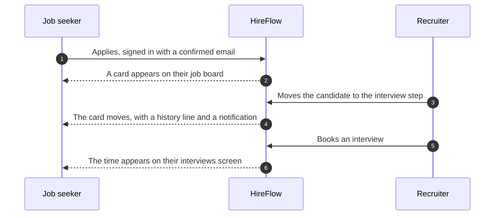
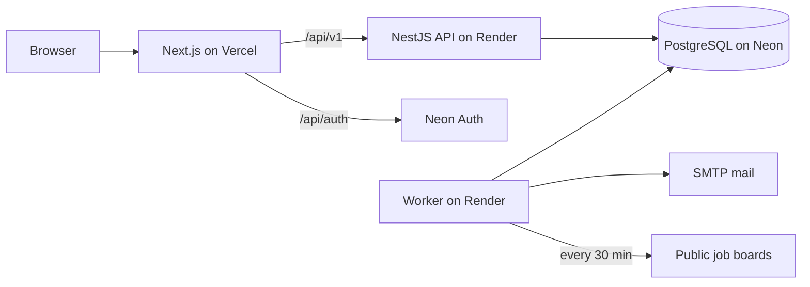

# HireFlow

A two-sided hiring platform. Job seekers track every application on one board, companies run their hiring on another, and the two stay in sync: when a recruiter moves a candidate, the candidate's own board moves with it.

**Live app:** [hire-flow-opal-five.vercel.app](https://hire-flow-opal-five.vercel.app) &nbsp;·&nbsp; **API health:** [hireflow-api-z8lc.onrender.com/api/v1/health](https://hireflow-api-z8lc.onrender.com/api/v1/health)

The app runs on free plans, so the first visit after a quiet spell can take up to a minute while the server wakes. The page shows a note while it waits.

---

## Contents

- [Features](#features)
- [Architecture](#architecture)
- [Tech stack](#tech-stack)
- [Getting started](#getting-started)
- [Configuration](#configuration)
- [Scripts](#scripts)
- [Testing](#testing)
- [Security](#security)
- [Deployment](#deployment)
- [Project structure](#project-structure)
- [Known limits](#known-limits)
- [License](#license)

## Features

### For job seekers

- **Job board.** Drag applications across saved, applied, first round, interview, offer and rejected. Notes, tags, search, archive and a full history for each card.
- **Live cards.** Apply to a company on HireFlow and the card follows their hiring process by itself, with a history line and a notification for each move.
- **Reminders.** A follow-up 7 days after applying, custom reminders, and a notice a day and an hour before each interview, in the app and by email.
- **Job feed and alerts.** New jobs from public company job boards every 30 minutes, with search by keyword, place and remote. Alerts send each new match once, or as a daily email at 8 am in your own time zone.
- **Resume check.** Upload a PDF or Word resume and get a 0 to 100 match score for any job, with the skills found, the skills missing and how the score was worked out.
- **Interview practice.** Log practice sessions. Each topic comes back for review on the SM-2 schedule, with streaks and totals.
- **Your numbers.** Applications per week, reply rate and how far each application got.

### For companies

- **Jobs and careers page.** Draft, publish and close jobs. A public careers page lists open roles, and candidates apply with a resume. No account needed.
- **Hiring board.** Custom steps for each job. Move candidates by drag and drop or keyboard. Turning someone down needs a written reason, which is never sent to the candidate.
- **Interview booking.** Working hours for each person, a free-time search across up to five people, and booking by a recruiter or through a signed link the candidate uses to pick a time. The database itself refuses double bookings.
- **Team and roles.** Admin, recruiter, hiring manager and interviewer. Interviewers only see the candidates assigned to them.
- **Hiring numbers.** Funnel, days to hire and where applicants came from, for any job and date range.
- **Activity log.** A read-only record of who changed what. The database blocks edits and deletes.

### How the two boards connect



A card is only created when the applicant is signed in with a confirmed email that matches the application. The form is public, so an email address alone proves nothing.

## Architecture



- **One database does it all.** PostgreSQL holds the data, the job queue (pg-boss) and full-text search. There is no Redis, cache or message broker to run.
- **The browser talks to one site.** Next.js forwards `/api/v1` to the API and `/api/auth` to Neon Auth, so there are no cross-site cookies.
- **The database enforces what matters.** No overlapping interviews for a person, one application per person and job, and an activity log that cannot be changed.
- **Shared validation.** One set of zod schemas checks both the forms and the API.
- **Safe to repeat.** Every background job gives the same result if it runs twice. Emails, alert deliveries and reminders go out once.

### Background jobs

| Job              | Runs             | Does                                                                             |
| ---------------- | ---------------- | -------------------------------------------------------------------------------- |
| `mail`           | On demand        | Renders and sends one email, retried 5 times with back-off                       |
| `reminders-scan` | Every minute     | Turns due reminders into notifications and emails                                |
| `resume-parse`   | After an upload  | Reads the file on a separate, memory-limited thread                              |
| `feed-fetch`     | Every 30 minutes | Reads each job board and saves new jobs. A failing board never blocks the others |
| `alerts-match`   | After each fetch | Matches new jobs to alerts, one delivery per pair                                |
| `alerts-digest`  | Every 15 minutes | Sends instant alerts, and daily ones at 8 am in each person's zone               |
| `cleanup`        | Daily at 03:00   | Removes old delivery rows and jobs gone from their boards                        |

## Tech stack

| Layer   | Technology                                                                              |
| ------- | --------------------------------------------------------------------------------------- |
| Web     | Next.js 16, React 19, Tailwind CSS 4, TanStack Query, dnd-kit, React Hook Form, Luxon   |
| API     | NestJS 12, Kysely, zod, jose, pino                                                      |
| Auth    | Neon Auth (managed Better Auth) with 6-digit email codes                                |
| Data    | PostgreSQL 15+, node-pg-migrate (12 reversible SQL migrations), pg-boss                 |
| Worker  | Node.js, nodemailer, unpdf and fflate for reading resumes                               |
| Tooling | pnpm workspaces, TypeScript, ESLint, Prettier, Husky, Vitest, Supertest, Playwright, k6 |
| Hosting | Vercel (web), Render (API and worker), Neon (database and auth), GitHub Actions (CI)    |

## Getting started

### Prerequisites

- Node.js 22 or newer, and Corepack for the right pnpm version: `corepack enable`
- PostgreSQL is not needed separately. `pnpm db:start` runs a private copy on port 5433.

### Run locally

```bash
pnpm install
cp .env.example .env          # then set NEON_AUTH_COOKIE_SECRET and LINK_SECRET
pnpm db:start                 # private PostgreSQL in .pgdata/
pnpm db:create                # development and test databases
pnpm db:migrate               # apply the schema
pnpm db:seed                  # optional: a demo company with jobs, people and an interview
pnpm feed:sources             # optional: the public job boards the worker reads
pnpm dev                      # web :3000, API :4000, worker, and sign-in :4300
```

Make each secret with `openssl rand -base64 48`, then open <http://localhost:3000>.

Everything works offline. `pnpm dev` starts a local stand-in for Neon Auth (`packages/local-auth`), which runs the same Better Auth with the same cookies and tokens. No email is sent in development. Emails, sign-up codes and reset links are saved to `.mail-preview/`, and the codes are also printed in the terminal.

### Demo accounts

`pnpm db:seed` creates a company, Northwind Labs, with these team members. Sign up with one of the addresses and enter the code from `.mail-preview/` to take over that account and its role.

| Account                         | Role           |
| ------------------------------- | -------------- |
| `admin@northwind.example`       | Company admin  |
| `recruiter@northwind.example`   | Recruiter      |
| `manager@northwind.example`     | Hiring manager |
| `interviewer@northwind.example` | Interviewer    |

Any other email gives you the job seeker side. The demo careers page is at `/c/northwind-labs`.

## Configuration

The API and worker check their settings on start and stop with a clear message if one is wrong. See [`.env.example`](.env.example) for a full example.

| Variable                                           | Used by     | Required      | Notes                                                     |
| -------------------------------------------------- | ----------- | ------------- | --------------------------------------------------------- |
| `DATABASE_URL`                                     | API, worker | Yes           | Direct connection, not a pooled one                       |
| `APP_URL`                                          | API, worker | Yes           | Public web address, used in email links                   |
| `CORS_ORIGINS`                                     | API         | Yes           | Allowed web addresses, comma separated                    |
| `NEON_AUTH_BASE_URL`                               | API, web    | Yes           | Neon Auth URL. Must be `https://` in production           |
| `NEON_AUTH_COOKIE_SECRET`                          | web         | Yes           | Signs the session cookie, 32+ characters                  |
| `LINK_SECRET`                                      | API         | Yes           | Signs booking and file links, 32+ characters              |
| `API_URL`                                          | web         | Yes           | API address. Set before the web build                     |
| `MAIL_FROM`                                        | API, worker | Yes           | Sender name and address                                   |
| `SMTP_HOST`, `SMTP_PORT`, `SMTP_USER`, `SMTP_PASS` | worker      | In production | Leave `SMTP_HOST` empty locally to save emails as files   |
| `TRUST_PROXY_HOPS`                                 | API         | No            | `2` when the web host forwards to the API on another host |
| `UPLOAD_DIR`                                       | API, worker | No            | Where resumes are stored. Default `uploads`               |
| `RATE_LIMIT_USER_PER_MIN`                          | API         | No            | Default 100                                               |
| `RATE_LIMIT_AUTH_PER_MIN`                          | API         | No            | Default 10, for public forms                              |
| `FOLLOW_UP_DAYS`                                   | API         | No            | Default 7                                                 |

## Scripts

| Command                           | What it does                                                                      |
| --------------------------------- | --------------------------------------------------------------------------------- |
| `pnpm dev`                        | Run everything with rebuild on change                                             |
| `pnpm build`                      | Build all packages. `build:web`, `build:server` and `build:render` build one side |
| `pnpm start`                      | Run the API and worker together in production                                     |
| `pnpm lint` / `pnpm typecheck`    | ESLint and TypeScript across the workspace                                        |
| `pnpm format` / `format:check`    | Prettier                                                                          |
| `pnpm test`                       | Unit and API tests against a real database                                        |
| `pnpm test:e2e`                   | Browser tests. Stop `pnpm dev` first, as they use the same ports                  |
| `pnpm coverage`                   | Coverage for the API, worker and shared code                                      |
| `pnpm db:migrate` / `db:rollback` | Apply or undo migrations                                                          |
| `pnpm db:seed`                    | Demo data, development only                                                       |
| `pnpm feed:sources`               | Add the starting list of public job boards                                        |

## Testing

| Level   | Tool              | Tests | Covers                                                                                 |
| ------- | ----------------- | ----- | -------------------------------------------------------------------------------------- |
| Shared  | Vitest            | 38    | Schemas, the resume score, the SM-2 schedule                                           |
| API     | Vitest, Supertest | 315   | Every route with every role, cross-company access, uploads, booking races, auth tokens |
| Worker  | Vitest            | 58    | Reminders, email delivery, job board adapters, alerts, resume reading                  |
| Browser | Playwright        | 30    | Sign-up with email codes, password reset, both user journeys, booking, live boards     |
| Load    | k6                | 2     | Read-heavy and mixed traffic, with speed targets as pass or fail                       |

Tests run against a real PostgreSQL database and never call the network. Job board tests replay recorded responses. API line coverage is 96.7%.

With 50 concurrent users, 95% of requests finished in under 23 ms for reads and 13 ms for mixed reads and writes, with no errors. That was measured on one laptop with everything on it.

CI runs on every push and pull request. It runs a dependency audit, lint, formatting, types, the migrations up, down and up again, every test, the build and the browser tests.

## Security

| Area             | Control                                                                                          |
| ---------------- | ------------------------------------------------------------------------------------------------ |
| Authentication   | Neon Auth handles passwords, sessions, email codes and resets. HireFlow stores no passwords      |
| API tokens       | Only Ed25519 tokens from Neon Auth, for the right issuer and audience, valid for 15 minutes      |
| Account linking  | An existing account is only linked to a sign-in with a confirmed email                           |
| Access control   | Role checked on every company route. Outsiders get a 404, so companies cannot be discovered      |
| Tenant isolation | Every company query uses the company id checked by the guard, never one from the request         |
| Uploads          | PDF or Word only, 5 MB, checked by content, random file names, short-lived signed download links |
| Rate limits      | 100 requests a minute per person, and 10 a minute per address on public forms                    |
| Audit            | Role changes, job publishing, step moves, feedback and deletions. Entries cannot be altered      |
| Supply chain     | `pnpm audit` in CI, and Dependabot updates                                                       |
| Safe start       | The API refuses to start in production with an unsafe setting                                    |

## Deployment

| Part           | Host                                | Setup                                                                |
| -------------- | ----------------------------------- | -------------------------------------------------------------------- |
| Web            | Vercel                              | Root Directory `apps/web`. Commands come from `apps/web/vercel.json` |
| API and worker | Render, free web service, Singapore | Blueprint from `render.yaml`                                         |
| Database, auth | Neon, free plan, Singapore          | Run `pnpm db:migrate` and `pnpm feed:sources` against it once        |

### Environment variables

**Render.** `render.yaml` fills in `NEON_AUTH_BASE_URL`, `LINK_SECRET`, `SMTP_PORT`, `NODE_ENV` and `TRUST_PROXY_HOPS`. Set these yourself:

`DATABASE_URL`, `APP_URL`, `CORS_ORIGINS`, `SMTP_HOST`, `SMTP_USER`, `SMTP_PASS`, `MAIL_FROM`

**Vercel.** Set all of these before the first build:

`API_URL`, `NEON_AUTH_BASE_URL`, `NEON_AUTH_COOKIE_SECRET`, `ENABLE_EXPERIMENTAL_COREPACK=1`

**Neon Auth.** Turn on email sign-in with a required 6-digit code, add the web address to the trusted domains, set your own SMTP server, and turn off "Allow localhost" once the site is live.

### Staying awake on free plans

Free hosts sleep when idle. The workflow in `.github/workflows/keep-alive.yml` pings `/api/v1/health` every 12 minutes, but only for as many hours a day as Neon's free compute can cover. Each run reads Neon's usage for the month and spreads the rest evenly, so the database is never suspended mid-month.

To set it up, add these in the repository's **Settings → Secrets and variables → Actions**:

| Kind     | Name                 | Value                                 |
| -------- | -------------------- | ------------------------------------- |
| Secret   | `RENDER_BACKEND_URL` | The Render address                    |
| Secret   | `NEON_API_KEY`       | A Neon API key scoped to this project |
| Variable | `NEON_PROJECT_ID`    | The Neon project id                   |

Without the Neon key it falls back to a fixed 10-hour window.

### Releasing

Run `pnpm db:migrate` against the live database when a release adds a migration. Then push to `main`, and Vercel and Render deploy on their own. Afterwards, check `/api/v1/ready`.

## Project structure

```
.
├── apps/
│   ├── api/              NestJS API, SQL migrations, OpenAPI spec and API tests
│   ├── web/              Next.js app and Playwright browser tests
│   └── worker/           Background jobs: mail, reminders, job feed, alerts, resumes
├── packages/
│   ├── shared/           Schemas, types, skills list and resume scoring used by every app
│   ├── config/           Shared TypeScript settings
│   └── local-auth/       Offline stand-in for Neon Auth, for development and tests only
├── scripts/              Local database, seeding, production start, keep-alive and load tests
├── .github/workflows/    CI and the keep-alive schedule
└── render.yaml           Render Blueprint
```

The API spec in `apps/api/openapi.json` is generated from the code with `pnpm --filter @hireflow/api openapi`, and a test fails if it ever drifts.

## Known limits

- Rate limits are kept in memory, so they assume one API instance.
- Resumes are stored on the server's disk. Render's free plan wipes it on restart, so durable storage needs a paid disk or an object store.
- Outside the keep-alive hours, reminders and alerts wait until the server next wakes.
- Interviews have one interviewer. Free-time search covers up to five people, but panel interviews are not built.
- Weekly numbers use UTC weeks.

## License

[MIT](LICENSE) © Manas Saxena
