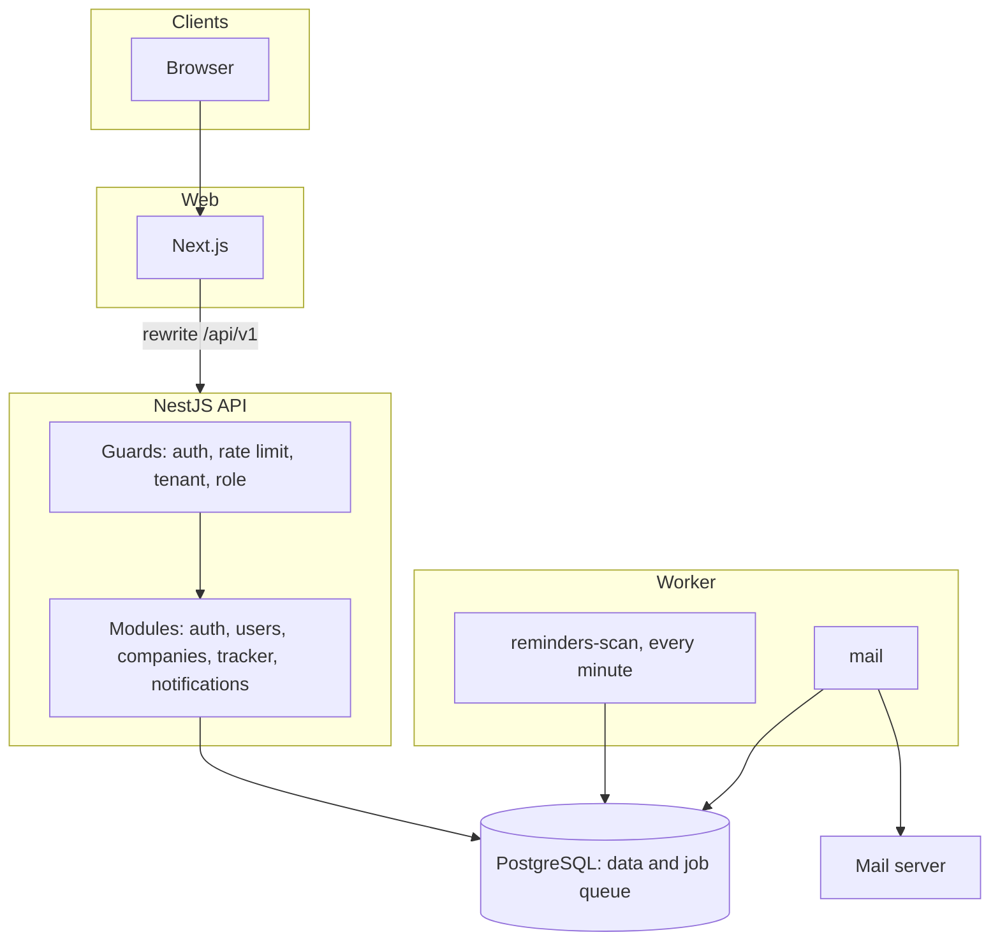

# Architecture

## Overview

The API is a modular monolith. Each feature is a NestJS module, and only the API and worker touch the database.

## Requests

Every request passes the same guards, in order:

1. **AuthGuard** verifies the bearer token unless the route is marked `@Public()`.
2. **AppThrottlerGuard** applies the per-user limit, and the stricter per-IP limit on credential routes.
3. **TenantGuard** runs when the route has `:cid`. It loads the caller's membership. A non-member gets a 404, so company ids cannot be probed.
4. **RolesGuard** checks the route's declared policy. A route with no policy is refused, which makes access deny-by-default. A test also walks every controller to confirm each route declares one.

Errors leave through one filter in a single format, with a request id that matches the logs.

## Sessions

- The access token is a 15-minute JWT, held only in memory in the browser.
- The refresh token is random, stored as an HMAC, sent as an `httpOnly` cookie scoped to `/api/v1/auth`, and rotated on each use.
- Presenting an already-rotated token revokes the whole family, because it means the token leaked or was replayed.
- The browser serialises refresh calls with a Web Lock. Without it, two tabs waking at once would look like a replay and sign the user out.
- The web app proxies `/api/v1` through Next.js rewrites, so the cookie stays first-party even with the API on another domain.

## Jobs and email

Jobs live in PostgreSQL through pg-boss, which has one large benefit over a separate broker: a job can be enqueued inside the transaction that caused it. A rolled-back registration can never send a verification email.

**Reminders** are claimed with `FOR UPDATE SKIP LOCKED`, so parallel workers never take the same row. The notification, the queued email and `sent_at` commit together. If the worker dies part way, everything rolls back and the next tick retries.

**Email** runs through `email_deliveries`, keyed by a dedupe key. The row and the send share a transaction: a failed send rolls back so the retry goes through, and a re-run of a job that already sent finds the row and stops.

## Data rules

- UUID primary keys; `timestamptz` everywhere, stored in UTC and converted at the UI edge.
- Schema changes go through numbered, reversible SQL migrations. CI applies them, rolls them back and applies them again.
- Every company-owned table carries `company_id`, and repositories for those tables take it as a required argument.
- `audit_logs` is append-only, enforced by a trigger.
