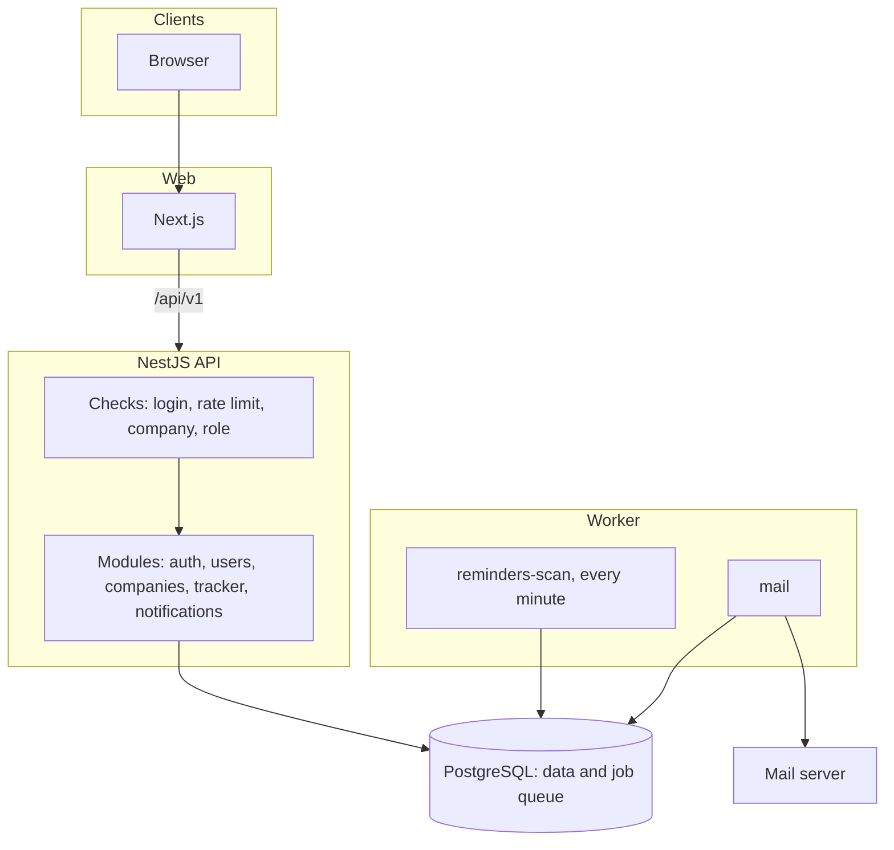

# How HireFlow works

## The big picture

The API is one app split into modules, one for each feature. Only the API and the worker can touch the database.

## What happens on each request

Every request goes through the same checks, in this order:

1. **AuthGuard** checks the login token, unless the route is marked `@Public()`.
2. **AppThrottlerGuard** checks the rate limit. Sign-in routes have a stricter limit.
3. **TenantGuard** runs when the route has `:cid`. It finds the user's role in that company. If they are not a member, they get a 404, so they cannot find out which companies exist.
4. **RolesGuard** checks if this role may use the route. A route that does not say who may use it is blocked. A test also checks that every route says this.

All errors have the same format and include a request id that matches the logs.

## How login works

- The access token lasts 15 minutes. The browser keeps it only in memory.
- The refresh token is a random value. The database stores only a hash of it. The browser keeps it in an `httpOnly` cookie that scripts cannot read.
- Each time the refresh token is used, it is swapped for a new one.
- If an old token is used again, it may be stolen, so all tokens in that family are cancelled. A token swapped in the last 10 seconds is the one exception. See [decision 003](decisions/003-access-behaviour.md).
- Browser tabs take turns refreshing, using a Web Lock. Otherwise two tabs at once would look like a stolen token.
- The web app sends `/api/v1` calls through Next.js, so the cookie keeps working even when the API is on another domain.

## Background jobs and email

Jobs are stored in PostgreSQL using pg-boss. The big benefit is that a job can be added in the same transaction as the change that caused it. If a sign-up fails and is undone, its email is cancelled too.

**Reminders:** the worker picks up due reminders with `FOR UPDATE SKIP LOCKED`, so two workers never take the same one. The notification, the email job and `sent_at` are saved together. If the worker crashes half way, nothing is saved and the next run tries again.

**Email:** the `email_deliveries` table remembers what was sent. If sending fails, the row is undone so a retry can send it. If the email already went out, the retry stops.

## Data rules

- IDs are UUIDs. Times are saved in UTC and changed to the user's time zone only on screen.
- Database changes are numbered SQL files that can be undone. CI runs them, undoes them and runs them again.
- Every table owned by a company has a `company_id`, and the code that reads it must be given one.
- Nobody can change or delete rows in `audit_logs`. A database trigger stops it.

## How hiring works

- Each company table has `company_id`, and every query filters on it. The company comes from the signed-in person's membership, never from the request body.
- A person moves through the steps of one job. Each move writes a history row and an audit log entry in the same transaction, and any step email is added to the queue in that transaction too.
- Interviewers are limited in one place: `findVisible` in `applications.service.ts`. It gives a 404 for anyone not given to them.
- The apply route checks the rate limit first, then keeps the file in memory with a 5 MB limit, then checks its bytes. The file is saved under a random name before the transaction, and it is removed again if the transaction fails.
- Resumes are downloaded through short-lived signed links, so the browser can save the file without sending the login token.
