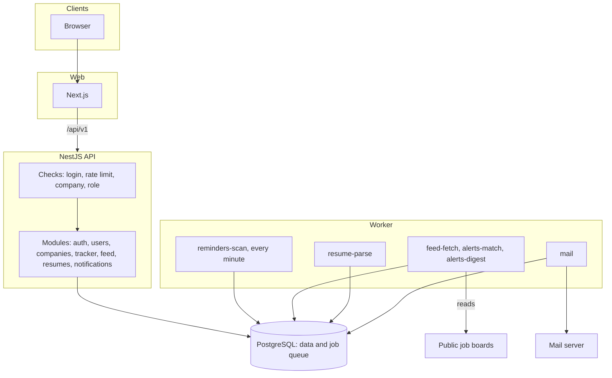

# How HireFlow works

## The big picture

The API is one app split into modules, one for each feature. Only the API and the worker can touch the database.

## What happens on each request

Every request goes through the same checks, in this order:

1. **AuthGuard** checks the login token, unless the route is marked `@Public()`.
2. **AppThrottlerGuard** checks the rate limit. Sign-in routes have a stricter limit.
3. **TenantGuard** runs when the route has `:cid`. It finds the user's role in that company. If they are not a member, they get a 404, so they cannot find out which companies exist.
4. **RolesGuard** checks if this role may use the route. A route that does not say who may use it is blocked. A test also checks that every route says this.

All errors have the same format and include a request id that matches the logs.

## How login works

- The access token lasts 15 minutes. The browser keeps it only in memory.
- The refresh token is a random value. The database stores only a hash of it. The browser keeps it in an `httpOnly` cookie that scripts cannot read.
- Each time the refresh token is used, it is swapped for a new one.
- If an old token is used again, it may be stolen, so all tokens in that family are cancelled. A token swapped in the last 10 seconds is the one exception. See [decision 003](decisions/003-access-behaviour.md).
- Browser tabs take turns refreshing, using a Web Lock. Otherwise two tabs at once would look like a stolen token.
- The web app sends `/api/v1` calls through Next.js, so the cookie keeps working even when the API is on another domain.

## Background jobs and email

Jobs are stored in PostgreSQL using pg-boss. The big benefit is that a job can be added in the same transaction as the change that caused it. If a sign-up fails and is undone, its email is cancelled too.

**Reminders:** the worker picks up due reminders with `FOR UPDATE SKIP LOCKED`, so two workers never take the same one. The notification, the email job and `sent_at` are saved together. If the worker crashes half way, nothing is saved and the next run tries again.

**Email:** the `email_deliveries` table remembers what was sent. If sending fails, the row is undone so a retry can send it. If the email already went out, the retry stops.

## Data rules

- IDs are UUIDs. Times are saved in UTC and changed to the user's time zone only on screen.
- Database changes are numbered SQL files that can be undone. CI runs them, undoes them and runs them again.
- Every table owned by a company has a `company_id`, and the code that reads it must be given one.
- Nobody can change or delete rows in `audit_logs`. A database trigger stops it.

## How hiring works

- Each company table has `company_id`, and every query filters on it. The company comes from the signed-in person's membership, never from the request body.
- A person moves through the steps of one job. Each move writes a history row and an audit log entry in the same transaction, and any step email is added to the queue in that transaction too.
- Interviewers are limited in one place: `findVisible` in `applications.service.ts`. It gives a 404 for anyone not given to them.
- The apply route checks the rate limit first, then keeps the file in memory with a 5 MB limit, then checks its bytes. The file is saved under a random name before the transaction, and it is removed again if the transaction fails.
- Resumes are downloaded through short-lived signed links, so the browser can save the file without sending the login token.

## How interview booking works

- **The database stops double booking.** Two rules on the `interviews` table refuse overlapping times for one interviewer or one candidate. The code never checks first and then saves, because two requests can both pass a check at the same moment. It just saves, and turns a refusal into `SLOT_TAKEN`. Two saves racing can also end in a deadlock error from PostgreSQL, which means the same thing.
- **Free times** come from `slots.ts`, which has no database code, so it is easy to test. It works out each person's hours date by date in their own zone, removes days off and other interviews, keeps the time everyone shares, and cuts it into start times on the quarter hour.
- **Clock changes:** times are saved in UTC and worked out in the person's zone with Luxon. So 9 o'clock stays 9 o'clock on their clock. An interview across the change keeps its real length.
- **Booking in one transaction:** the interview, the interviewer's access to the candidate, the reminders, the emails and the audit entry are saved together.
- **Reminders:** each interview gets one row a day before and one an hour before. The worker turns a row into a notification and an email for the interviewer, and an email for the candidate. Moving or cancelling removes the rows that were not sent.
- **Candidates have no account**, so a signed link lets them book. The offer row holds the times. It can be booked only once, because the save only works while the offer has no interview on it. The link is hidden from the logs and the page tells search engines to stay away.

## How the job feed and alerts work

- **One shape for every source.** Each source has an adapter in `apps/worker/src/feed/`, which turns its answer into a `NormalJob`. To add a source, write an adapter and list it in `adapters.ts`.
- **`feed-fetch` runs every 30 minutes.** It reads enabled sources one by one, and each gets up to three tries. A source that fails is marked `failed` and the others carry on. A worker restart does not call a source fetched in the last 25 minutes.
- **No duplicates.** A job is saved once for its `(source_id, external_id)`, and `job_hash` keeps one copy when two sources list the same job. The hash is title, company and place, the same one the tracker uses, so the feed can tell if a job is already on your board.
- **`alerts-match` runs after each fetch.** It looks at jobs with no `matched_at`, adds a delivery row for each alert that fits, and sets `matched_at` in one transaction. The delivery row's primary key is what makes sure an alert has a job only once.
- **Sending.** Instant alerts go right after matching. `alerts-digest` runs every 15 minutes, sends daily alerts in the hour after 8 am on each person's clock, and picks up any instant ones left waiting. For each person, the email job, the notification and the delivered marks are saved in one transaction, so a retry cannot send a job twice.

## How resumes and the match score work

- **Upload.** The API checks the bytes of the file, saves it under a random name, and adds a `resume-parse` job in the same transaction as the database rows.
- **Reading.** The worker opens the file on a separate thread with a time and memory limit, then saves the text and skills. Resume text never goes in the logs, and it is not sent back by the API.
- **The score** is in `packages/shared/src/matcher.ts`. It has no database code, clock or random value, so the same resume and job always get the same score: `round(100 * (0.65 * coverage + 0.25 * keywordSim + 0.10 * sections))`.
- **Coverage** is the share of the job's skills found in the resume. Skills under headings like Requirements count double.
- **keywordSim** compares the important words of the two texts, using TF-IDF and cosine similarity.
- **Sections** is the share of the headings experience, education, skills and projects found in the resume.
- **Honest advice.** A missing required skill gives one suggestion: add it only if you have real experience with it.
